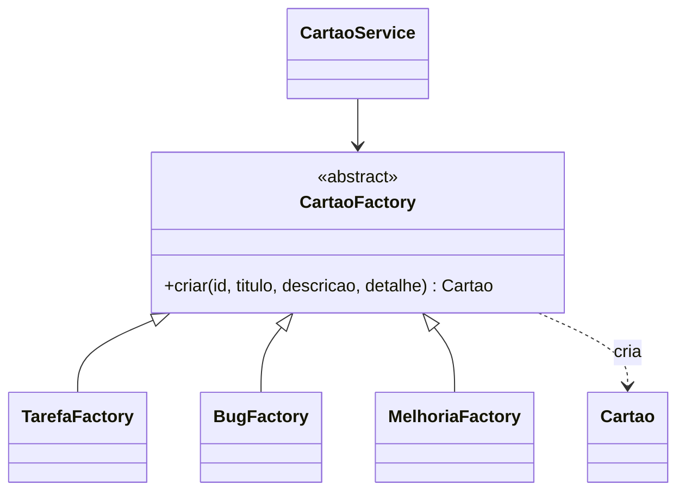
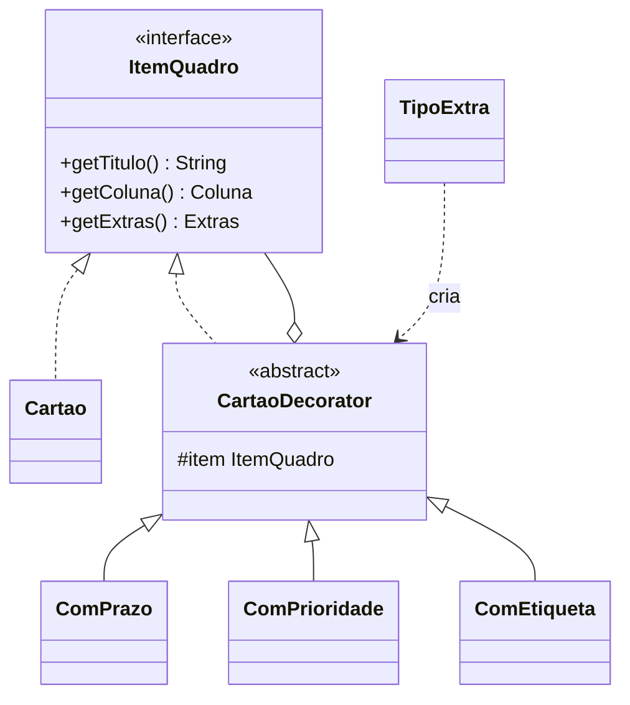
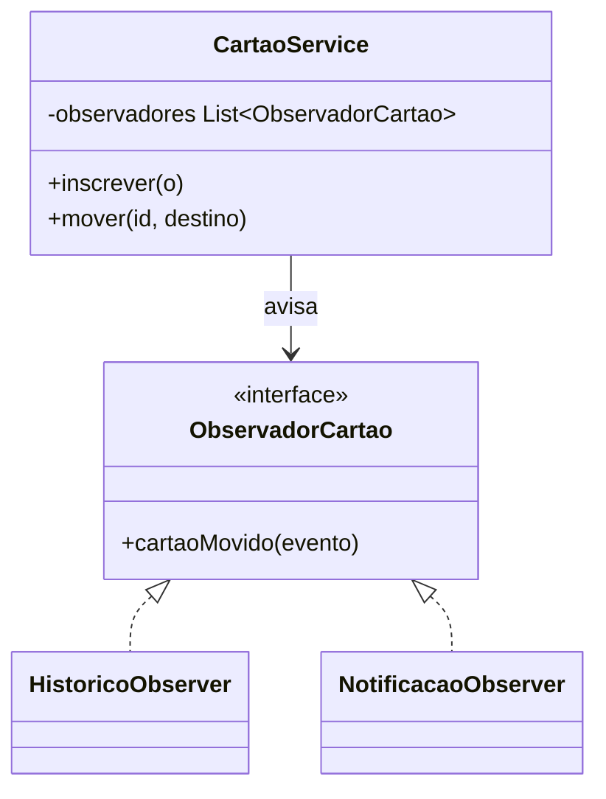

# Padrões de projeto

## Factory Method (criacional)

**Problema:** cada tipo de cartão tem regras próprias. Um bug, por exemplo, pode exigir os passos para reproduzir e já nascer com prioridade alta. Com `new Cartao(...)` espalhado pelo código, cada regra nova vira um `if (tipo == BUG)`.

**Solução:** uma fábrica abstrata `CartaoFactory` com o método `criar(...)`, e uma fábrica concreta por tipo. O `CartaoService` escolhe a fábrica pelo tipo e não precisa saber como cada cartão é montado.

O método recebe `id`, `titulo`, `descricao` e `detalhe`. O campo `detalhe` é obrigatório e seu significado depende do tipo: critérios de aceite para TAREFA, passos para reprodução para BUG e justificativa para MELHORIA. Cada fábrica valida esse campo e cria o cartão do próprio tipo. O campo é devolvido pela API e exibido no quadro. Prioridade permanece fora desta issue, pois os extras combináveis serão tratados pelo Decorator.

## Decorator (estrutural)

**Problema:** um cartão pode ter prazo, prioridade, etiqueta ou várias dessas coisas juntas. Criar uma subclasse para cada combinação (`CartaoComPrazoEPrioridade`...) explode o número de classes.

**Solução:** uma interface comum para o cartão e decoradores que envolvem um cartão e acrescentam um extra. Os decoradores podem ser empilhados: `new ComPrazo(new ComPrioridade(cartao, ALTA), prazo)`.

O `Cartao` e o `CartaoDecorator` implementam `ItemQuadro`. O decorador repassa todas as chamadas para o item que envolve, e cada decorador concreto sobrescreve só o `getExtras()`, somando o seu extra aos extras do item de dentro. O cartão sem decorador devolve `Extras.NENHUM`. Quando o mesmo extra aparece duas vezes, vale o decorador mais externo; etiquetas se acumulam sem repetir.

O `CartaoService` guarda o cartão original e a versão decorada de cada cartão. O `POST /api/cartoes/{id}/extras` usa o `TipoExtra` para escolher o decorador e envolve a versão atual. Como o decorador consulta o cartão original, mover o cartão continua refletindo na versão decorada.

## Observer (comportamental)

**Problema:** quando um cartão muda de coluna, várias partes do sistema precisam reagir: o histórico registra, as notificações avisam e, no futuro, as métricas contam. Se o `CartaoService` chamar cada uma diretamente, ele fica acoplado a todas.

**Solução:** o serviço é o sujeito e mantém uma lista de observadores. Ao mover um cartão, ele avisa todos com um evento, e cada observador decide o que fazer.

No front, o histórico e as notificações aparecem em um painel ao lado do quadro.
